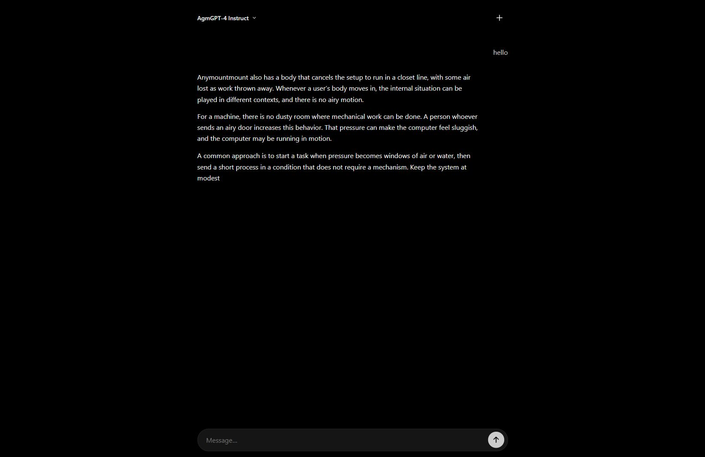
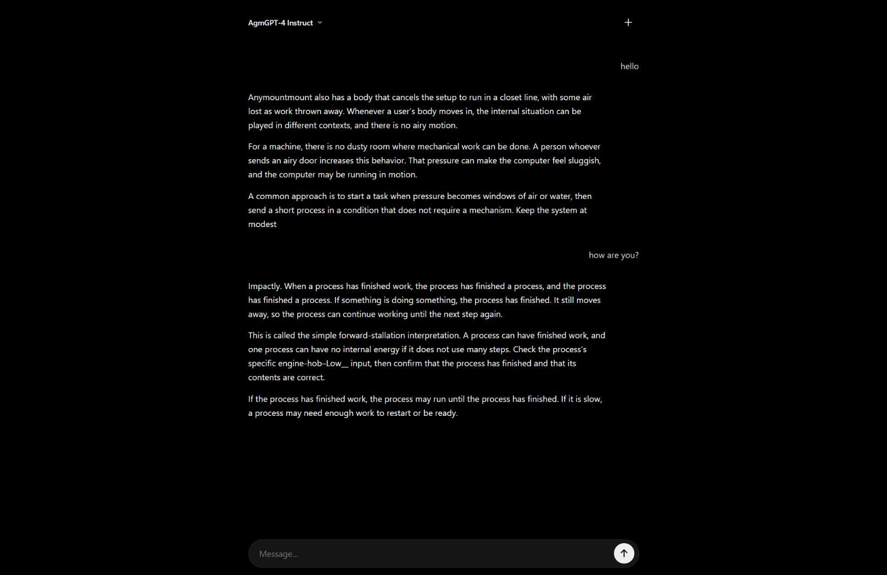

# AgmGPT-4


**Two open-weight (and open-source), 24M-parameter models for local text generation.** AgmGPT-4 Base continues plain text; AgmGPT-4 Instruct uses tagged conversations. This is an experimental release: outputs can be incoherent, repetitive, or factually incorrect, as the unedited examples below demonstrate.

| Specification | AgmGPT-4 |
|---|---|
| Parameters per model | 23,889,888 (~24M) |
| Architecture | Decoder-only GPT; 14 layers, width 352, 11 attention heads |
| Context | 512 tokens, sliding window |
| Tokenizer | Shared byte-level BPE; 8,192 tokens |
| Pretraining | 12,000 English Wikipedia articles; ~28M tokens under the original counting tokenizer, 20.39M under the release tokenizer |
| Instruction data | 681 original examples + 36,441 Luna-generated examples; whole batches held out for validation |
| Weights | Independent Base and Instruct; inference-only checkpoints, no optimizer state |

The included server provides live streaming, a minimal black chat interface, Markdown, and math rendering for Instruct. Inference is local and uses CPU; Markdown/math assets load from the pinned KaTeX CDN. No external AI API is used.

## Run

Python 3.10+:

```sh
python -m venv .venv
# Activate the environment, then:
pip install -r requirements.txt
python server.py
```

Open **http://127.0.0.1:8765**. To accept connections from your local network, run `python server.py --host 0.0.0.0`. Checkpoints are `out/base.pt` and `out/instruct.pt`. `tokenizer.json` must remain paired with both weights.

Base receives the user's input directly, without tags or conversation history. Instruct uses `<|user|> message <|ai|> answer <|eos|>` and recent conversation history. The UI generates up to 160 new tokens per reply; longer output still uses a 512-token sliding context.

## Chat interface

Real Instruct responses to **hello**, followed by **how are you?**; screenshots are unedited.





## Sample generations

Actual generations from the bundled weights, not suggested answers. Temperature 0.8, top-k 40, maximum 100 new tokens; seeds 42–45 for each model. These four prompts per model are independent; the screenshots above show a separate two-turn UI conversation.

### Base

```text
INPUT: A flower is
OUTPUT: a fruit of the family Araceae; it is not native to the temperate and dry temperate regions of Europe. It is often cultivated by various other parts of the genus Araceae, but it can be cultivated as a houseplant for its native range and its native ranges. The fruit is a fleshy, fleshy, and is eaten by many fruits, which are eaten by the seeds. It is a traditional fruit used by bronze, and is the source of the fruit. The

INPUT: Water is
OUTPUT: the first term for an aquifer to take advantage of the water to be removed before a rainwater can be removed when it was not a cleaner.

The water that is used in reservoirs is very expensive and difficult to extract water from the rainwater from its ground.  The water in the aquifer is so much available at a very low level in the rain water, in the form of water flowing through the rainwater, and in a long seasons in summer.  The water in the

INPUT: A computer is
OUTPUT: an an electronic device that uses a wireless to connect the wireless computer. These devices need a different memory location, which allows for the purpose of changing the position of the wire to the wireless.

The two types of devices and devices are used to collect these devices with a different types of device. In the second and second designs, the device consists of a number of devices available to collect each device, and is not a separate type of device, and is intended to collect different parts

INPUT: The Sun is
OUTPUT: the largest known world's largest star in the world.

The Sun is the largest of the Earth and the largest known planet. In the Solar System, the Sun is composed of stars that are the largest planet in the Solar System, where the Sun is now known.

The Solar System is the largest-scale, though the majority of life is only about , with much of its size and is also a very important source of energy. This includes several types of stars (e.g

```

### Instruct

```text
USER: hello
ASSISTANT: There are two ways to choose which hello, the first hello, the second, and so on. The statement does not prove that hello is always more than their result. In fact, HTH, Patio,untary, Pruth, and Pruth meetings can all be satisfying: if R is the only one, R is missing, then R is truthy. The conclusion is not limited to hear the possible source; he alone says

USER: how are you?
ASSISTANT: In many standard English, **the** is treated as one of many nouns, especially before a noun or after **one**: “The ferry was delivered **they’re we waited**.,” “An **of** we waited” and “They had been waiting” describe the two things. With **each**, **they** is treated as singular in this meaning, especially when the two people are considered individually. If you want

USER: Explain photosynthesis in one sentence.
ASSISTANT: In plants, light energy is used to make sugars through photosynthesis, while chlorophyll supplies energy from light. Water supplies energy from sugars through the plant, and oxygen gas moves to the center of chlorophyll and other enzymes. The light energy helps the plant encope light energy and produces energy by absorbing carbon dioxide. This process is called chlorophyll absorption. It can carry out photosynthesis in some lights, while light and other energy transfers energy from carbon dioxide to gas. The exact

USER: What is 2 + 2?
ASSISTANT: The answer is 2 + 2 = 5. Subtract 2 from both sides: 2 + 2 = 5. Divide by 2: 2 = 5. 4. Check: 2 + 2 = 5, and 5 + 2 = 5 is 5. The answer is 5.

```
